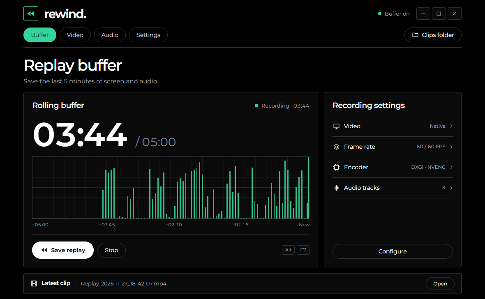
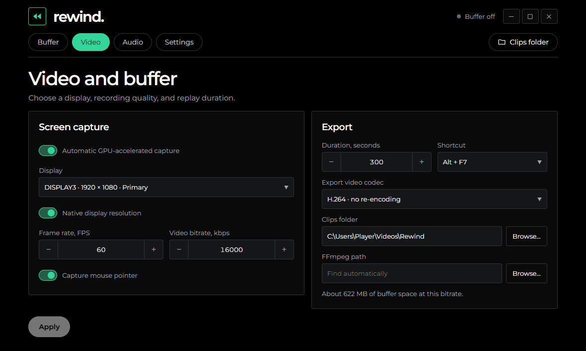
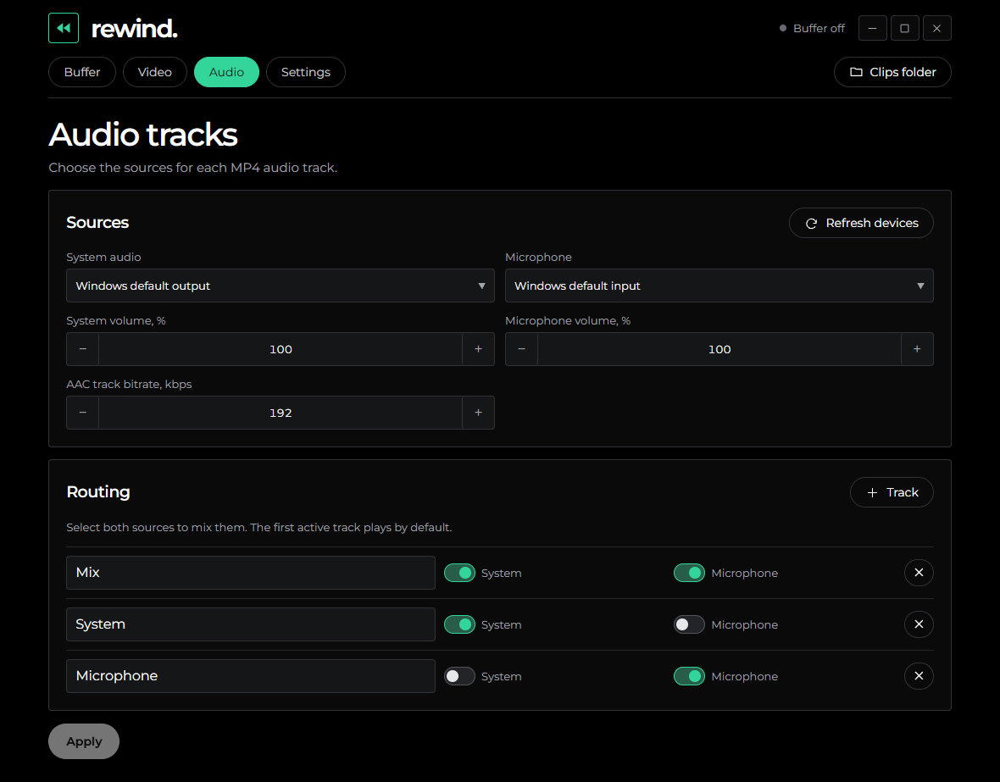

# Rewind

[Русский](README.md)

Instant replay for Windows.



## Features

- Replay buffer from 10 seconds to 30 minutes, with a five-minute default.
- DXGI or GDI screen capture with configurable resolution, frame rate, and bitrate. Supports NVIDIA NVENC, AMD AMF, and Intel Quick Sync on compatible hardware.
- Up to ten audio tracks from system audio, the microphone, or individual apps. Per-app capture is available on Windows 10 version 2004 or later and Windows 11.
- H.264, H.265, or AV1 export. H.264 clips retain the original video stream.
- Recording controls in the system tray, save and error notifications, and English and Russian interfaces.

| Video settings | Audio settings |
| --- | --- |
|  |  |

## Usage

1. Run `Rewind.exe` and select **Start buffer**.
2. Save a replay with the hotkey set under **Video**. The default is **Alt + F10**. You can also save from the main window or the tray menu.
3. Open the MP4 with **Open** or find it in the **Clips folder**.

Left-click or right-click the tray icon to open the tray menu, where you can start or stop the buffer. Double-click it to open the main window. By default, closing the window asks whether to quit or minimize to the tray. You can change the language, interface scale, and close behavior under **Settings**.

Enable **Start with Windows** in Settings to open Rewind when you sign in. If the buffer was running, a fresh buffer starts when Rewind launches automatically.

To record an app on its own, open it and select it in a track’s dropdown under **Audio**. A closed app contributes silence. Its audio resumes on the same track when it reopens.

In **Settings**, you can disable automatic update checks or check manually. Rewind offers to download new versions from GitHub Releases and installs the update after recording stops and you confirm the restart.

Rewind stores the buffer in `%LOCALAPPDATA%\Rewind\buffers`. Recording continues while the app is in the tray. Quitting clears the temporary files. After a clip is saved, the buffer starts filling again. Clips go in the `Rewind` subfolder of your Windows Videos folder by default.

## Build

Requires Windows 10 or 11, Microsoft Edge WebView2 Runtime, Rust 1.90 or later with an MSVC target, and Visual Studio Build Tools with C++ and the Windows SDK. The interface uses Tauri 2. Capture and export use Rust, WASAPI, and FFmpeg.

```powershell
cargo build --release --locked
```

The executable is `target\release\rewind.exe`. Rewind looks for FFmpeg at the configured path, next to the executable, in `PATH`, and in its data folder. If FFmpeg is missing when you start the buffer, you can download it, choose an existing `ffmpeg.exe`, or quit. Rewind verifies the archive checksum after downloading.

## Checks

```powershell
cargo fmt --all -- --check
cargo clippy --locked --all-targets -- -D warnings
cargo test --locked
```

For capture and export tests, put FFmpeg and FFprobe in `PATH` and run `cargo test --locked recorder::tests -- --include-ignored`.

Montserrat is distributed under the [SIL Open Font License 1.1](ui/fonts/OFL.txt).
