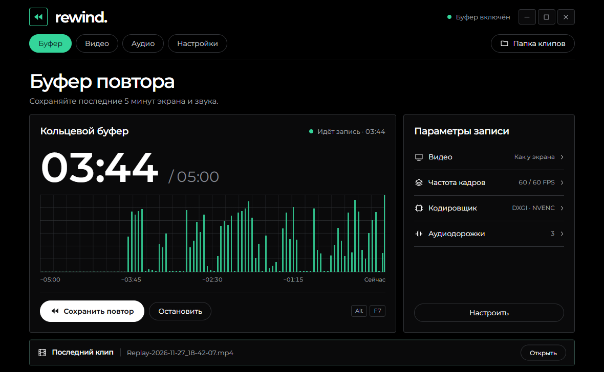
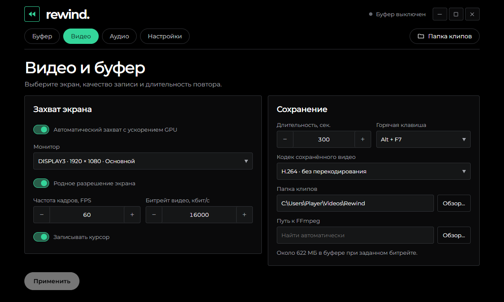
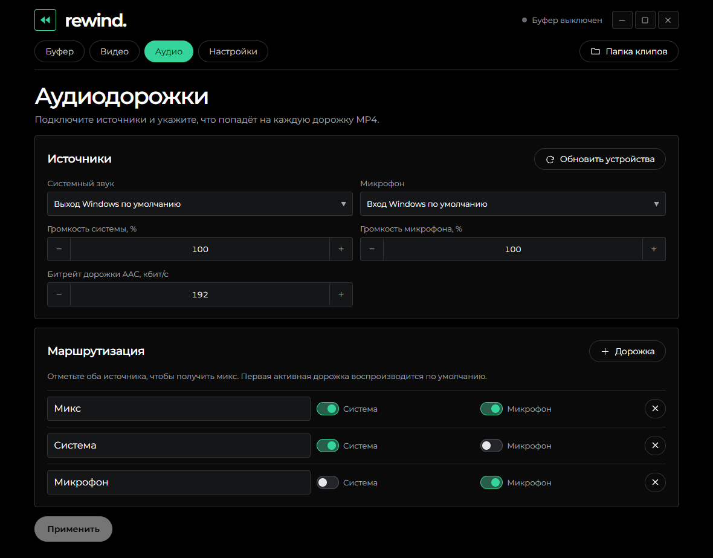

# Rewind

[English](README.en.md)

Мгновенные повторы для Windows.



## Что умеет

- Кольцевой буфер от 10 секунд до 30 минут. По умолчанию он хранит последние пять минут.
- Захват экрана через DXGI или GDI с настройками разрешения, FPS и битрейта. При наличии поддержки используются NVIDIA NVENC, AMD AMF или Intel Quick Sync.
- До десяти аудиодорожек из системного звука, микрофона и отдельных приложений. Захват звука приложений доступен в Windows 10 версии 2004 и новее, а также в Windows 11.
- Экспорт H.264, H.265 или AV1. H.264 сохраняется без перекодирования видео.
- Управление записью из трея, уведомления о сохранении и ошибках, русский и английский интерфейс.

| Настройки видео | Настройки аудио |
| --- | --- |
|  |  |

## Как пользоваться

1. Запустите `Rewind.exe` и нажмите **«Включить буфер»**.
2. Сохраните повтор горячей клавишей из раздела **«Видео»**. По умолчанию это **Alt + F10**. Сохранение также доступно из главного окна и меню трея.
3. Откройте готовый MP4 кнопкой **«Открыть»** или через **«Папка клипов»**.

Одинарный левый или правый клик по значку открывает меню трея. В нём можно включить или остановить буфер. Двойной левый клик открывает главное окно. При закрытии окна Rewind по умолчанию спрашивает, выйти или свернуться в трей. Язык, масштаб интерфейса и поведение при закрытии можно изменить в **«Настройках»**.

Включите **«Запускать с Windows»** в настройках, чтобы Rewind открывался при входе в систему. Если буфер был активен, при автозапуске он начнёт наполняться заново.

Чтобы записать звук отдельного приложения, запустите его и выберите в списке рядом с дорожкой в разделе **«Аудио»**. Пока приложение закрыто, в его канале будет тишина. После повторного запуска звук вернётся в ту же дорожку.

В **«Настройках»** можно отключить автоматическую проверку обновлений или запустить её вручную. Rewind предлагает скачать новую версию с GitHub Releases и устанавливает её после остановки записи и подтверждения перезапуска.

Буфер хранится в `%LOCALAPPDATA%\Rewind\buffers`. При сворачивании в трей запись продолжает обновлять его. При выходе временные файлы удаляются. После успешного сохранения буфер начинает наполняться заново. Готовые клипы находятся в папке видео Windows, в подпапке `Rewind`, если вы не выбрали другую.

## Сборка

Нужны Windows 10/11, Microsoft Edge WebView2 Runtime, Rust 1.90+ с целью MSVC и Visual Studio Build Tools с компонентами C++ и Windows SDK. Интерфейс работает на Tauri 2, захват и экспорт — через Rust, WASAPI и FFmpeg.

```powershell
cargo build --release --locked
```

Сборка создаёт `target\release\rewind.exe`. Rewind ищет FFmpeg по пути из настроек, рядом с приложением, в `PATH` и в папке данных Rewind. Если FFmpeg не найден, при запуске буфера можно скачать его, указать путь к `ffmpeg.exe` или выйти. При скачивании Rewind проверяет контрольную сумму архива.

## Проверки

```powershell
cargo fmt --all -- --check
cargo clippy --locked --all-targets -- -D warnings
cargo test --locked
```

Для тестов захвата и экспорта установите FFmpeg и FFprobe в `PATH`, затем запустите `cargo test --locked recorder::tests -- --include-ignored`.

Montserrat распространяется по [SIL Open Font License 1.1](ui/fonts/OFL.txt).
